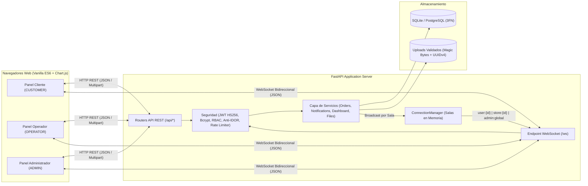

# Kinetix Orders (`realtime-orders-ws`)

Sistema de despacho, trazabilidad y analítica de pedidos multi-tienda en tiempo real construido con **Python 3.12, FastAPI, WebSockets nativos (RFC 6455), SQLAlchemy 2.0 y JavaScript ES6 Vanilla**.

---

## Arquitectura del Sistema



---

## Características Principales

- **Motor WebSocket con Aislamiento por Salas (`ConnectionManager`)**:
  - Enrutamiento en memoria hacia canales dedicados: `user:{id}` (privado por usuario), `store:{id}` (operadores de una sucursal específica) y `admin:global` (supervisión consolidada), con deduplicación automática de destinatarios.
  - Autenticación de *handshake* por primer mensaje JSON (`{"type": "auth", "token": "..."}`) o parámetro de consulta, validación de cabecera `Origin` (mitigación de *Cross-Site WebSocket Hijacking*) y ciclo de *Heartbeat* (`ping`/`pong`) cada 25 segundos.
  - Reconexión automática en el cliente mediante **Backoff Exponencial con Jitter** y resincronización de estado contra la API REST tras recuperar conectividad.
- **Máquina de Estados Estricta y Trazabilidad Financiera**:
  - Flujo controlado en el servidor: `RECEIVED -> PREPARING -> READY -> DELIVERED` (y cancelación condicionada `CANCELLED`).
  - Cálculo 100% en servidor con `Decimal` y patrón **Snapshot** en `order_items` (`product_name_snapshot`, `unit_price_snapshot`) para preservar la integridad contable histórica ante cambios futuros de precios.
  - Registro inmutable de auditoría en `order_status_history` con sello temporal UTC (`created_at`, `ready_at`, `updated_at`) y autor de cada transición.
- **Seguridad Aplicada (RBAC + Anti-IDOR + Subida Segura de Archivos)**:
  - Contraseñas hasheadas con **Bcrypt** (12 rondas) y tokens **JWT (`HS256`)** con expiración.
  - Control de acceso basado en roles (`CUSTOMER`, `OPERATOR`, `ADMIN`) y validación de pertenencia a nivel de objeto (**Anti-IDOR**) tanto en endpoints HTTP como en acciones entrantes por WebSocket.
  - Validación binaria de archivos subidos (imágenes de catálogo y comprobantes de pago) verificando **Magic Bytes** reales (`PNG`, `JPEG`, `WEBP`, `PDF`), lectura acotada en *streaming* (`<= 2 MB`), renombrado con `UUIDv4` aleatorio contra *Path Traversal* y descarga autenticada fuera de `/static` para comprobantes privados.
- **Notificaciones Híbridas y Dashboard Analítico en Vivo**:
  - Persistencia de notificaciones en base de datos combinada con entrega instantánea por WebSocket, contador de no leídas y marcado individual o masivo.
  - Panel analítico en tiempo real para `OPERATOR` y `ADMIN` con KPIs (pedidos activos, ventas del día UTC, tiempo promedio de preparación en minutos) y gráficos de **Chart.js** actualizados *in-place* mediante eventos `dashboard_update`.

---

## Estructura del Proyecto

```text
realtime-orders-ws/
├── app/
│   ├── core/           # Configuración (.env), conexión SQLAlchemy, JWT/Bcrypt, Rate Limiter y Seed
│   ├── models/         # Modelos ORM en 3FN (Store, User, Product, Order, OrderItem, History, Notification)
│   ├── schemas/        # Contratos Pydantic v2 para REST y sobres WebSocket (WSEnvelope)
│   ├── services/       # Lógica de dominio (orders, notifications, files, dashboard)
│   ├── routers/        # Endpoints HTTP REST (/api/auth, /stores, /products, /orders, /notifications, /files, /dashboard)
│   ├── websocket/      # ConnectionManager de salas y router /ws
│   └── main.py         # Punto de entrada FastAPI y middlewares de seguridad
├── static/
│   ├── css/styles.css  # Sistema de diseño stone-blueprint (Host Grotesk + JetBrains Mono)
│   ├── js/             # Módulos ES6 (app.js, api.js, ws_client.js, dashboard_charts.js)
│   └── index.html      # Interfaz SPA multi-rol
├── tests/              # Suite de pruebas de integración y seguridad (pytest)
├── Dockerfile          # Imagen de producción Python 3.12-slim (non-root)
├── docker-compose.yml  # Orquestación con volúmenes persistentes
└── requirements.txt    # Dependencias fijadas
```

---

## Ejecución Local

### 1. Clonar y configurar entorno virtual

```powershell
git clone git@github.com:GabrielMartinez97/realtime-orders-ws.git
cd realtime-orders-ws
python -m venv .venv
.\.venv\Scripts\Activate.ps1
pip install -r requirements.txt
Copy-Item .env.example .env
```

### 2. Iniciar el servidor de desarrollo

```powershell
.\.venv\Scripts\uvicorn.exe app.main:app --host 127.0.0.1 --port 8000 --reload
```

Abre `http://localhost:8000` en varias pestañas del navegador (cada pestaña mantiene su sesión independiente en `sessionStorage`). El sistema incluye cuentas semilla listas para probar en 1 clic:

| Rol | Correo | Contraseña | Alcance |
| :--- | :--- | :--- | :--- |
| `CUSTOMER` | `ana@cliente.com` | `Cliente123!` | Canal personal (`user:4`) |
| `CUSTOMER` | `carlos@cliente.com` | `Cliente123!` | Canal personal (`user:5`) |
| `OPERATOR` | `operador.centro@tiendas.com` | `Operador123!` | Sucursal Centro (`store:1`) |
| `OPERATOR` | `operador.norte@tiendas.com` | `Operador123!` | Sucursal Norte (`store:2`) |
| `ADMIN` | `admin@tiendas.com` | `Admin123!` | Supervisión global (`admin:global`) |

---

## Ejecución con Docker

```bash
docker compose up --build -d
```

El contenedor se ejecuta bajo un usuario sin privilegios (`appuser`), expone la aplicación en `http://localhost:8000` y persiste la base de datos y los archivos subidos en los volúmenes `orders_data` y `orders_uploads`.

---

## Pruebas Automatizadas

La suite de `pytest` valida cabeceras de seguridad, *rate limiting*, integridad de precios y *snapshots*, autenticación WebSocket, aislamiento de salas, prevención de IDOR, *magic bytes* de archivos y métricas en tiempo real:

```powershell
.\.venv\Scripts\pytest.exe -v
```

---

## Evolución y Escalabilidad Horizontal (Roadmap)

- **Escalado Multi-Instancia con Redis Pub/Sub**: Para desplegar múltiples réplicas de Uvicorn/Gunicorn detrás de un balanceador de carga, el `ConnectionManager` puede conectarse a un bus **Redis Pub/Sub** (`broadcaster`) de modo que un evento originado en el Worker A se propague a los clientes conectados al Worker B.
- **Migración a PostgreSQL Asíncrono (`asyncpg`)**: El esquema ORM en SQLAlchemy 2.0 es 100% compatible con PostgreSQL cambiando únicamente `DATABASE_URL=postgresql+psycopg://...` en `.env`.
- **Almacenamiento de Objetos (S3 / Cloud Storage)**: Sustituir el almacenamiento local en `uploads/` por URLs prefirmadas (*Presigned URLs*) con validación en un worker dedicado.
